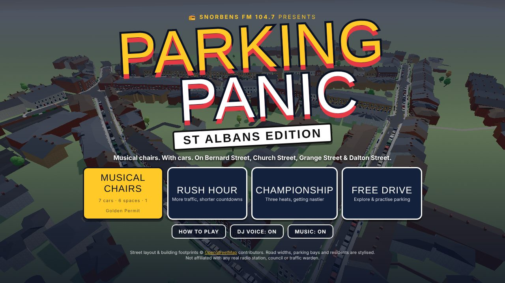
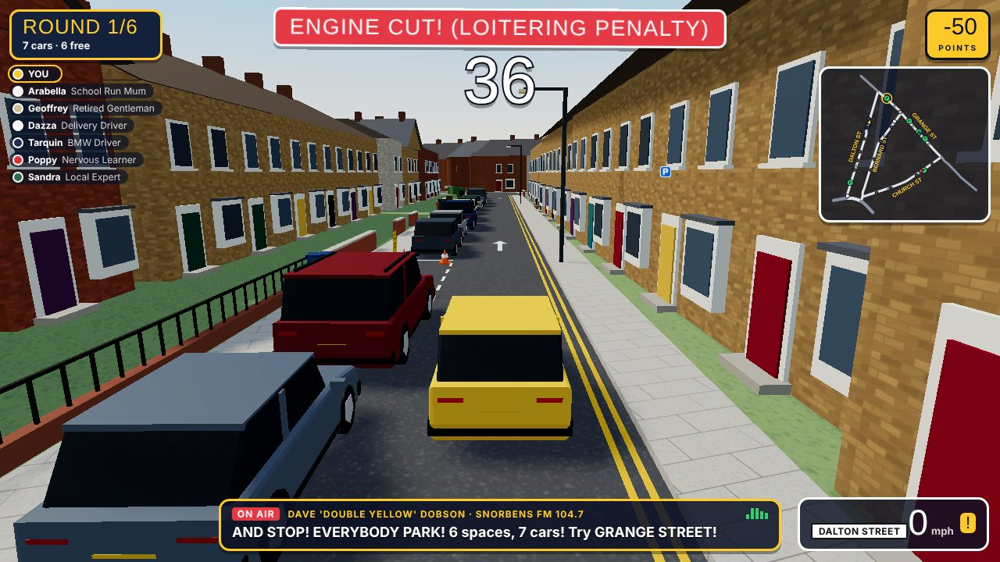
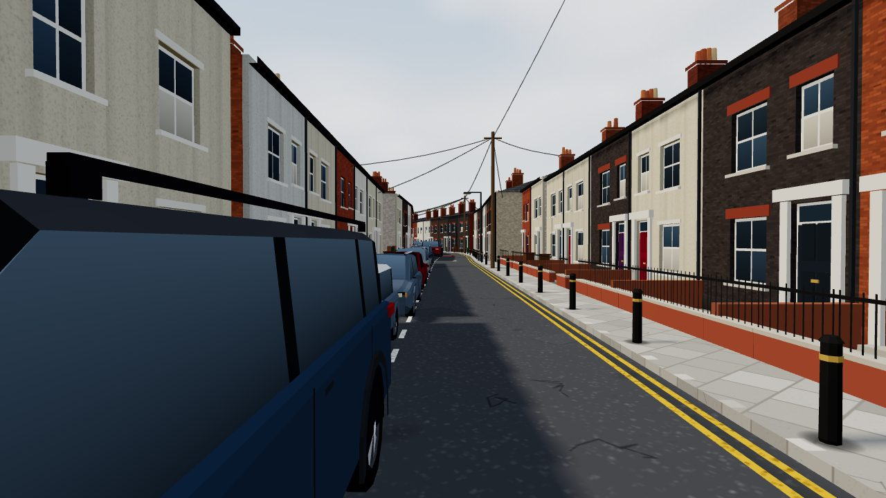

# PARKING PANIC: St Albans Edition

Musical chairs, but with cars and parking spaces, on four real streets in St Albans, Hertfordshire:
**Bernard Street, Church Street, Grange Street and Dalton Street**. Hosted by Dave "Double Yellow" Dobson
of Snorbens FM 104.7 (Hertfordshire's third-best breakfast show), who believes this is the greatest sporting
spectacle the county has ever seen.





## Play it

No build step needed, the bundled game is committed:

- **Quickest:** open `index.html` in a desktop or mobile browser.
- **Or serve it:** `npm install && npm run serve`, then visit <http://localhost:8080>.

Audio and the DJ's voice start after your first click/tap (browser rules). The DJ speaks using your browser's
speech synthesis where available (a British voice if you have one) and is always subtitled.

### Controls

| | |
|---|---|
| `W` / `↑` | Accelerate |
| `S` / `↓` | Brake, then reverse |
| `A` `D` / `←` `→` | Steer |
| `Space` | Handbrake |
| `C` | Chase camera / overhead parking camera |
| `H` | Horn |
| `M` / `P` | Mute / pause |
| Touch | On-screen steering buttons and pedals appear on phones and tablets |

## How the game works

1. **Music plays.** Seven cars circulate clockwise. Bays along the kerb are coned off ("PARKING SUSPENDED").
   Keep moving (hover next to a bay and your engine is cut when the music stops) and scout.
2. **Music stops.** The DJ screams, the cones come off some bays, and there is always **one fewer space than
   cars**. The minimap rings your best bet in yellow.
3. **Park properly.** Your car has to be inside the bay, roughly straight, not sticking out, and stopped.
   Parking sensors beep; a Parking Assist panel tells you what is wrong. Tidy parks score bonus points,
   wonky ones are "abandoned, not parked" and fined.
4. Whoever is left without a space when the clock runs out is eliminated. When one space remains the DJ cuts
   the clock. One space fewer each round, until two cars fight over the last one for the **Golden Parking Permit**.

**Rivals** each drive and park differently: the School Run Mum (enormous SUV, will shunt you), the Retired
Gentleman (slow, parks like a Swiss watch), the Delivery Driver (fast, sloppy), the BMW Driver (aggressive,
never indicates), the Nervous Learner (stalls, shuffles, falls for driveways) and the Local Expert (reacts
instantly, dawdles where she knows the bays are).

**Random events** with real consequences: the bin lorry, a surprise permit zone, the school run, the DJ's fake
space (a driveway), a delivery van sitting in your space, and the Perfect Spot.

**Modes:** Musical Chairs, Rush Hour (more traffic, shorter clocks), Championship (three heats of increasing
nastiness, score carried over) and Free Drive (explore and practise). Best scores for each competitive mode are
kept in your browser and shown on the title screen.

## What is real, and what is not

Geography comes from OpenStreetMap (© OpenStreetMap contributors, ODbL). `tools/build_map.py` converts an OSM
extract into `src/mapdata.js`.

**Taken from OSM, at true scale:**

- The centrelines and junctions of Bernard St, Church St, Grange St, Dalton St and the short stretch of
  Catherine St that joins them, including the fact that Grange Street's north-west end is a dead end.
- One-way working on Church Street and Bernard Street, the 20 mph limit, the speed cushions on Bernard Street
  and Grange Street, and the alley/driveway access points (these are the game's "fake spaces").
- About 230 building footprints in the surrounding blocks, and the other nearby roads, paths and car parks
  (drawn for context, not drivable).

**Stylised or invented, on purpose:**

- **Road widths.** OSM has no widths here. Carriageways are 5.6 m with parking down one side, and building
  fronts are trimmed back by up to about 1.5 m where that would not otherwise fit between the real footprints.
- **Parking.** Bay positions, which side of each street has parking, double yellow lines and the "permit zone"
  are generic UK conventions, not a survey of the real restrictions. Do not plan your actual parking with this.
- **The competition one-way loop.** So that drivers circulate like musical chairs, everyone goes clockwise:
  Dalton St north, Grange St south-east, Church St west, Bernard St north. Dalton and Grange are two-way in
  real life; the game only penalises wrong-way driving on the genuinely one-way streets.
- **Closed roads.** Barriers stop you leaving via Catherine Street and St Peter's Street.
- Building heights, roofs, doors, windows, garden walls, trees, street furniture, residents and their cars.
- Snorbens FM, the DJ and all contestants are fictional.

## Code layout

```
index.html, style.css     page, HUD and screens
dist/game.js              built bundle (committed so the game runs without a build)
src/
  mapdata.js              generated from OpenStreetMap by tools/build_map.py
  track.js                street network, kerb distance field, kerbside layout, AI lane paths
  physics.js              car model, box collisions, kerb collisions, parking evaluation
  ai.js                   rival personalities, lane following, queueing, bay choice, parking manoeuvres
  game.js                 rounds, bay release, eliminations, scoring, penalties, random events
  dj.js                   commentary lines + speech/subtitle queue, driven by game events
  audio.js                synthesised music, jingles, engine, sensors and effects (WebAudio, no files)
  world3d.js              Three.js scene: streets, houses, props, signs, bay markers
  carmodels.js            procedural vehicles
  ui.js                   HUD, minimap, tutorial, results, touch controls, high scores
  main.js                 render loop, camera, input, replays, particles, wiring
tests/
  sim.test.mjs            headless full-competition simulations and rule checks   (npm test)
  browser.test.mjs        Playwright smoke test of the real bundle + screenshots    (npm run test:browser)
  balance.mjs             balance report using a "competent human" autopilot      (npm run balance)
```

The simulation (`track`, `physics`, `ai`, `game`) has no rendering code in it, so whole competitions can be run
in Node. `npm run build` rebuilds `dist/game.js` with esbuild; `npm run dev` rebuilds on change and serves.

Useful URL parameters: `?auto` (autopilot plays for you), `?seed=123` (repeatable game), `?low` (lower
graphics settings), `?noshadows`.

## Known limitations

- Nobody has played this with a real steering thumb for more than a few seconds of automated key presses:
  the handling, parking tolerances and time limits were tuned by simulation, so the difficulty may need
  adjusting to taste (`pickRelease`, `stopMusic` and `evaluatePark` are the places to look).
- The streets are a single lane wide and there is no overtaking, so a slow rival in front of you stays in
  front of you. That is deliberate, and also quite annoying.
- Balance comes from simulated players (`npm run balance`), not from people. Expect to retune the countdown
  and how often rivals nip into your space once real players have tried it.
- Nobody has listened to the synthesised music and sound effects on real speakers yet.
- Below roughly 20 frames per second the game slows down rather than skipping physics steps.
- The DJ's voice depends on what speech voices your browser and operating system provide.

## Credits

- Map data © [OpenStreetMap](https://www.openstreetmap.org/copyright) contributors, Open Database Licence.
- 3D rendering by [three.js](https://threejs.org/) (MIT). Everything else (models, textures, music, sound) is
  generated in code.
